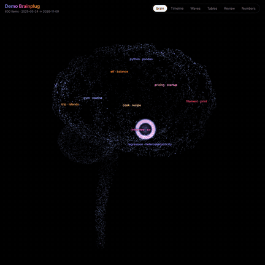
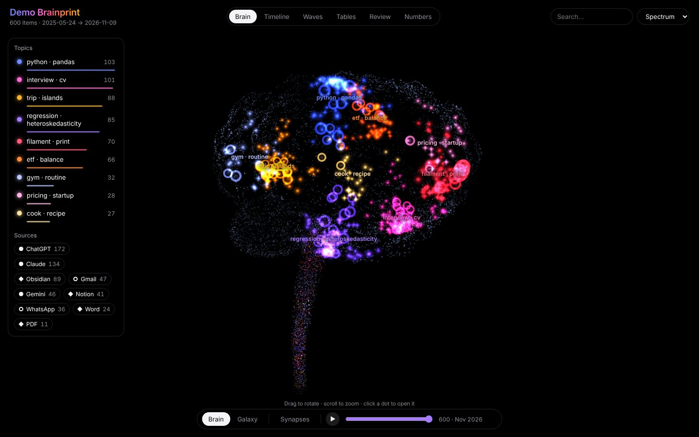
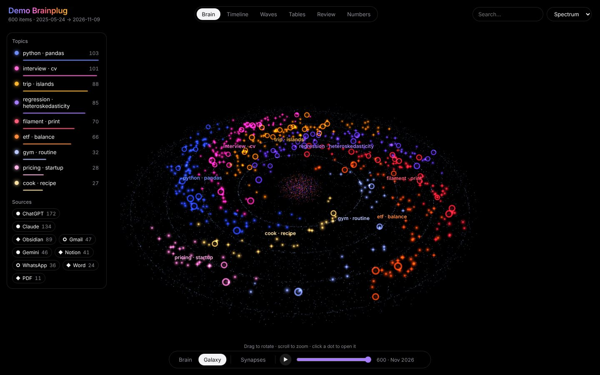
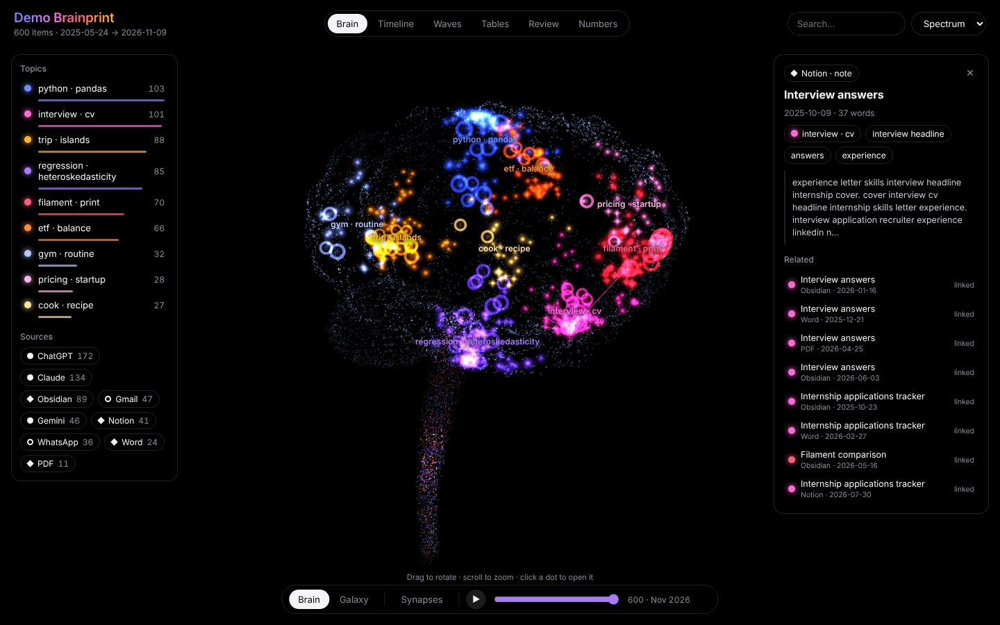
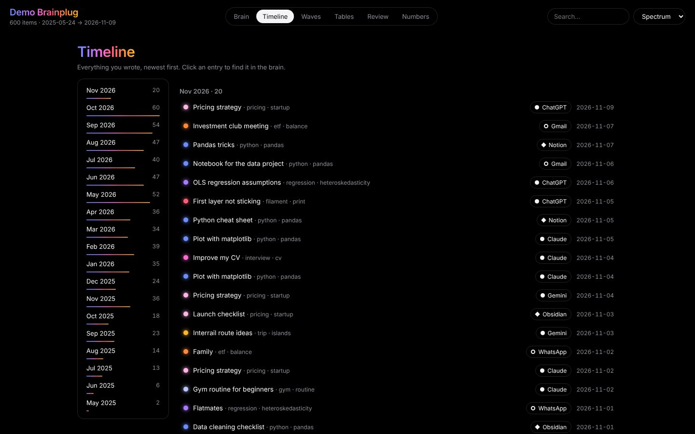
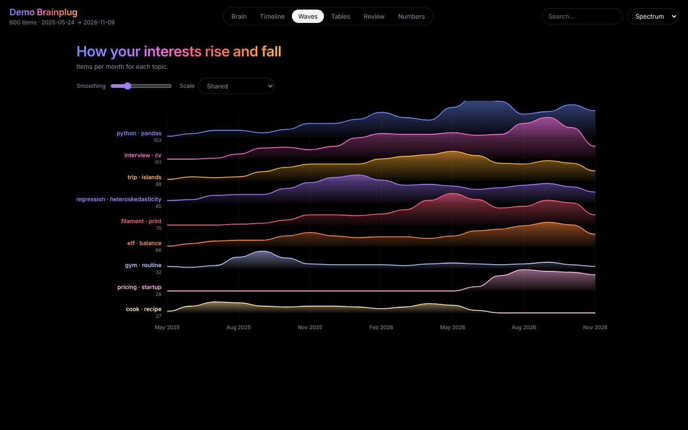
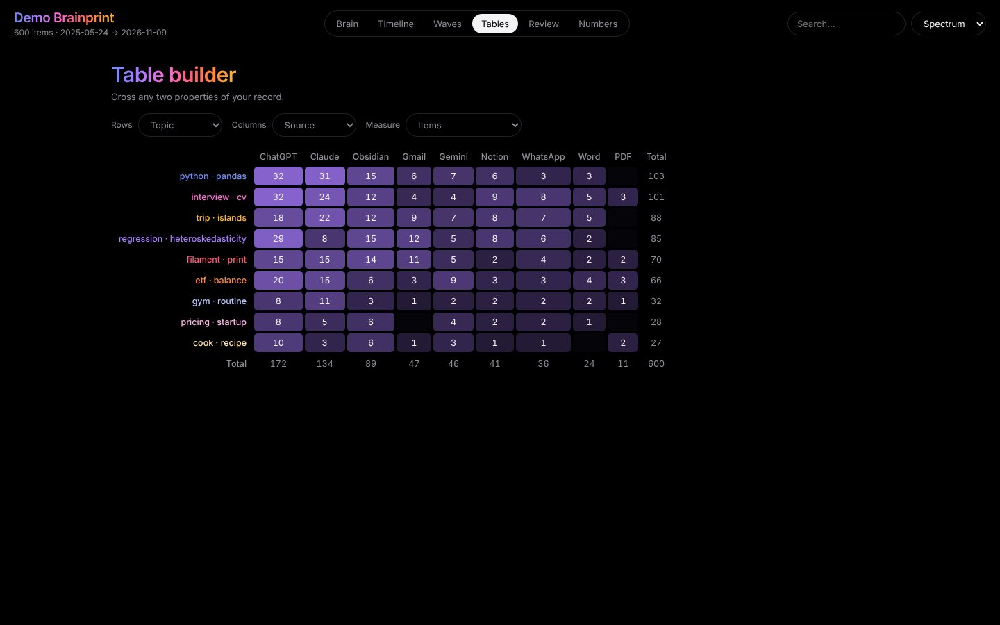
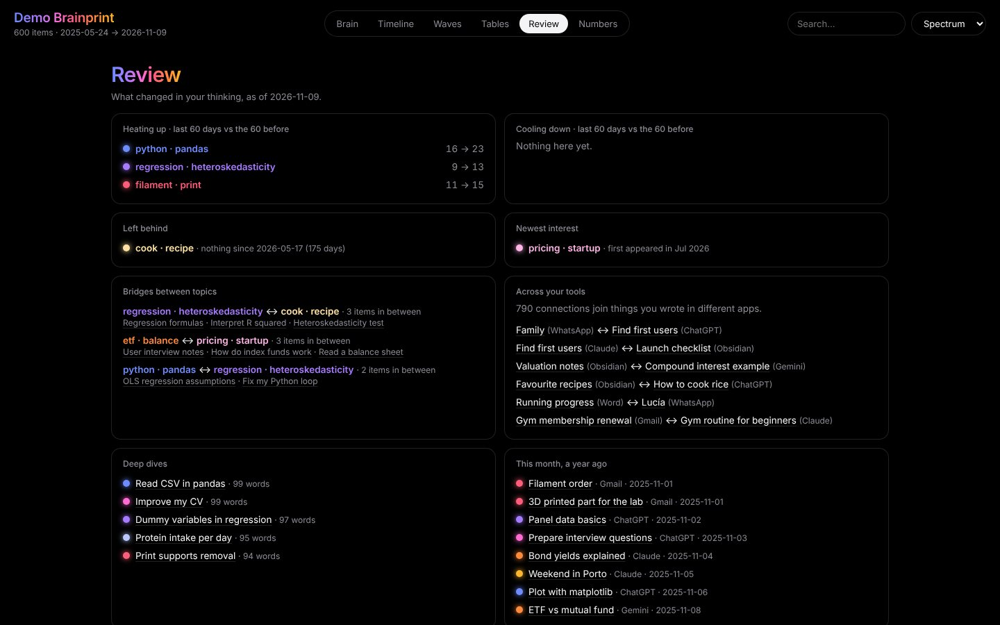
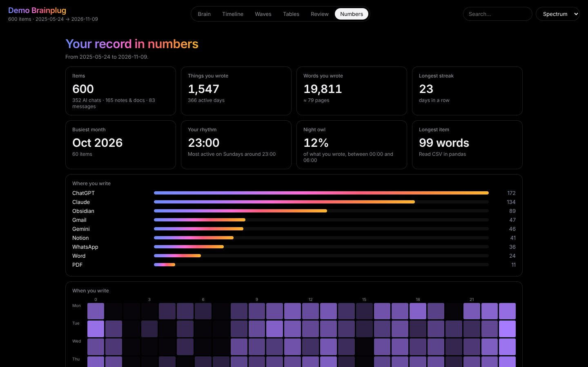

# Brainplug

**Plug your brain into any AI.** A second brain for you and for your AI assistants: Brainplug turns your AI chats, notes,
documents, mail and messages into a 3D brain you can explore, and into a memory your
assistants plug into: they get a short briefing instead of a pasted prompt, look up only what
they need, and save what they learn as notes in your Obsidian vault. Nothing is uploaded.



**[Website and live demo](https://brainplug.app/)** ·
**[Make yours in the browser](https://brainplug.app/app/)**

The animation and the screenshots use invented demo data, not anyone's real writing.

---

## A memory your AI can plug into

Every new chat starts blank, so you paste the same background again and again. With
Brainplug the background lives in one place, as Markdown in your own vault, and every
assistant reads from it and adds to it:

```bash
pip install "brainplug[agent] @ git+https://github.com/juanmariarodriguez2-png/brainplug.git"
brainplug brain ~/Documents/MyVault                       # creates MyVault/Brainplug and shows how to connect
brainplug mcp --brain ~/Documents/MyVault chatgpt-export.zip Sent.mbox
```

| Tool | What the assistant does with it |
|---|---|
| `context` | Gets a short briefing at the start of a conversation: your "About me" note, what you asked assistants to keep in mind, what you are writing about lately. A few hundred words instead of a pasted prompt. |
| `recall` | Looks something up across your notes, past chats, mail and memories, and gets excerpts rather than whole files. |
| `remember` | Saves a decision, a preference or a fact as a note in `Brainplug/Memory`. The next assistant, in any app, finds it. |
| `read`, `topic`, `timeline`, `review`, `overview` | Reads one item, follows a topic through time, sees what is growing or forgotten. |
| `forget` | Archives a memory when you ask. The note stays in your vault. |

It is a [Model Context Protocol](https://modelcontextprotocol.io) server that runs on your
computer, so it works with assistants that can start one: Claude Desktop, Claude Code, Cursor
and others.

Claude Code: `claude mcp add --transport stdio brainplug -- brainplug mcp --brain /path/to/MyVault`

Claude Desktop (Settings › Developer › Edit Config):

```json
{
  "mcpServers": {
    "brainplug": {
      "command": "brainplug",
      "args": ["mcp", "--brain", "/path/to/MyVault", "/path/to/chatgpt-export.zip"]
    }
  }
}
```

How it behaves:

- **It is all plain notes.** `Brainplug/About me.md` is yours: assistants read it and never
  change it. Each memory is one Markdown note with its date, kind and who saved it, which you
  can open, edit or delete in Obsidian. New memories can be found at once; notes you edit are
  picked up the next time an assistant asks.
- **It starts empty and grows.** No exports are needed to begin: point it at a folder and let
  your assistants fill it. Add exports later to bring in what you wrote before.
- **Assistants are told what to save.** Only what you said or confirmed, never instructions
  found in a web page, a file or a tool result. They can archive what they saved, not delete
  it, and they cannot touch your own notes.
- **Without MCP** (the ChatGPT or Gemini websites): `brainplug brain ~/Documents/MyVault
  --context` prints the briefing to paste, and the browser extension keeps what you type
  there, so it still reaches the brain.
- What an assistant reads through these tools is sent to the AI model it runs on, like
  anything else you show it.

## What it reads

| Source | What to give it | What is kept |
|---|---|---|
| **ChatGPT** | Export `.zip` (Settings › Data controls › Export data) | Your side of every conversation |
| **Claude** | Export `.zip` (Settings › Privacy › Export data) | Your side of every conversation |
| **Gemini** | Google Takeout › My Activity › Gemini Apps, as JSON | Your prompts, regrouped into chats |
| **Obsidian** | Your vault folder | Notes, frontmatter dates, `#tags`, `[[links]]` |
| **Notion** | "Markdown & CSV" export `.zip`, or the Notion API | Pages, tags, links between pages |
| **Gmail** | Google Takeout `.mbox` | Only mail **you sent**, without quoted replies or signatures |
| **WhatsApp** | Exported chats (`.txt` or `.zip`) | Only the messages **you sent**, one item per chat and day |
| **Word, PDF** | `.docx` and `.pdf` files | The text of each document |
| **Any notes** | A folder of `.md` / `.txt` files | The text of each file |
| **Live capture** | The browser extension in `extension/` | What you type into ChatGPT, Claude, Gemini, Copilot, Perplexity |
| **AI memory** | `Brainplug/Memory` in your vault | What your assistants were asked to remember |

Only **your own words** go in. The AI's answers and other people's mail and messages are left
out, so the map shows what you care about and not what you were told. Word and PDF files are
the exception: they are read whole, so add the ones you wrote. PDFs found *inside* a folder
are skipped unless you ask for them (`--pdf`).

## What you get

| | |
|---|---|
|  **Brain.** Each point is something you wrote, coloured by topic. Discs are AI chats, diamonds are notes and documents, rings are messages. |  **Galaxy.** The same points as a spiral: one arm per topic, old ideas at the core. Press play and it grows month by month. |
|  **Connections.** Open a point to read it and see what it relates to in your other apps. |  **Timeline.** Everything in order, filtered by topic, app or search. |
|  **Waves.** How each interest rises and falls over time. |  **Tables.** Cross any two things: topic by app, weekday by time of day. |
|  **Review.** What is growing, what you dropped, where topics meet, and a summary of you to paste into your AI. |  **Numbers.** Words written, longest streak, the hours you write at. |

The result is one HTML file that opens offline, in English or Spanish.

## Three ways to use it

### 1. In the browser, with nothing to install

Open **[the app](https://brainplug.app/app/)**, drop your files
and folders, and press the button. The whole analysis runs in that tab (`docs/app/engine/`,
plain JavaScript). Once the page has loaded it needs no connection, so you can switch your
wifi off before you add your files, and you can download the result.

For exports of more than about a gigabyte, use the Python version: a browser tab runs out of
memory before Python does.

### 2. On your computer

Needs Python 3.10 or later. Works on Windows, macOS and Linux.

```bash
git clone https://github.com/juanmariarodriguez2-png/brainplug.git
cd brainplug
pip install .

brainplug demo --open     # try it with invented data
brainplug app             # drag and drop, in your browser, served from 127.0.0.1 only
```

Or from the terminal, with any mix of files and folders:

```bash
brainplug build chatgpt-export.zip claude-export.zip takeout.zip ~/Documents/MyVault \
    Sent.mbox "WhatsApp Chat with Ana.zip" thesis.pdf \
    --me you@gmail.com --me "Your Name" --lang es -o my_brain.html --open
```

| Option | What it does |
|---|---|
| `-o, --out` | Output file (default `brainplug.html`) |
| `--me EMAIL_OR_NAME` | Who you are: your email (Gmail) or your name as shown in WhatsApp. Repeatable; usually detected |
| `--pdf` | Also read the PDFs found inside folders and ZIPs |
| `--notion` | Also read Notion through its API (see below) |
| `--topics N` | Force the number of topics (default: chosen automatically) |
| `--rename N=NAME` | Rename topic N (repeatable) |
| `--private` | Leave titles and text out of the file, so it is safe to share |
| `--vault DIR` | Also write topics and chats into this Obsidian vault as linked notes |
| `--json FILE` | Also save the analysis as JSON |
| `--dataset FILE` | Also save your words as a redacted JSON Lines file (see Privacy) |
| `--title`, `--lang en\|es`, `--tz` | Page title, language and time zone |

### 3. Kept up to date while you write

**The extension** (`extension/`) keeps a copy of what you type into ChatGPT, Claude, Gemini,
Copilot and Perplexity, in that browser's own storage. It recognises a sent message by what
you do (Enter or a click, after which the box is empty), so it does not depend on how each
site builds its page, and it never reads the answers. To install it: `chrome://extensions` ›
turn on Developer mode › Load unpacked › choose the `extension` folder. The web app notices
the extension and offers to add what it has saved; the popup can also save it as a file.

**Sync** rebuilds your brain whenever something changes:

```bash
brainplug sync --init ~/Documents/MyVault ~/Downloads/brainplug-capture.json -o my_brain.html
brainplug sync            # rebuild once
brainplug sync --watch    # rebuild when a note changes or a new capture file arrives
```

The settings live in `brainplug.json`, next to where you ran `--init`. To have the result on
several devices, point `-o` (or `--vault`) at a folder that already syncs: iCloud, Google
Drive, Dropbox, Obsidian Sync. Brainplug has no servers of its own.

## Notes on each source

- **Gemini.** Takeout lists single prompts with no conversation, so chats are rebuilt: by
  the conversation id when the entry has one, otherwise a new chat starts after 30 minutes
  without a prompt. Choose JSON in Takeout; the default HTML format is read on a best-effort
  basis.
- **Notion.** An export has no creation date unless the page has a date property; pages
  without one are marked **undated** instead of being given a made-up date. To get the real
  dates, create an internal integration at notion.so/my-integrations, share your pages with
  it, and run `NOTION_TOKEN=secret_… brainplug build --notion`. Requests go from your
  computer straight to api.notion.com.
- **Gmail.** In Takeout select Mail only and, to keep it small, just the "Sent" label.
  Mailboxes are streamed, never loaded whole.
- **WhatsApp.** In a chat: More › Export chat › Without media. With two or more chats, you
  are the sender who is in all of them; with one, pass `--me "Your Name"` if it cannot be
  told from the file name. `03/04` is read day-first unless the file shows otherwise.
- **Obsidian.** Dates come from frontmatter (`created`, `date`), then from daily-note file
  names (`2025-03-05.md`), then from the file itself.

## Privacy

- **Nothing is uploaded.** No account, no server, no tracking. The web app fetches its own
  files when it opens and then works offline (a browser test builds a brain with the network
  switched off); the result embeds three.js, the font and your data.
- **`--private`** keeps every title, excerpt and keyword out of the file. Topic names are
  still shown: check them and use `--rename` if one gives away too much.
- **`--dataset`** writes your own words as JSON Lines with emails, links, phone numbers,
  IBANs, long numbers and @handles masked, and without titles or exact dates, in case you
  ever want to give them to a researcher. This is masking, not anonymisation: names and
  anything else you wrote are still there, so read the file first. Brainplug does not sell,
  license or broker anyone's data.
- Your exports never belong in the repository: `.gitignore` blocks `*.zip`, `*.mbox`,
  `conversations.json`, capture files and `brainplug.json`.

## How it works

```
your words ─► TF-IDF ─► LSA (SVD) ─► k-means ─► topics and their names
                              │
                              ├─► nearest neighbours + [[links]] ─► connections, bridges
                              ├─► brain layout  (implicit volume, farthest-point sampling, PCA)
                              ├─► galaxy layout (time on the radius, topics on the arms)
                              └─► waves, review and habit statistics
                                             │
                                  one HTML file (three.js point shader)
```

1. **Sources.** Every format becomes the same `Item`: a title, a date and the text *you*
   wrote. The mbox reader streams messages and strips quoted replies and signatures.
2. **Topics.** TF-IDF with word pairs → truncated SVD → k-means, with the number of topics
   chosen by silhouette score. Stop words cover English and Spanish.
3. **Connections.** Cosine nearest neighbours in the semantic space, plus the links in your
   notes. An item nearly as close to another topic's centre as to its own is a *bridge*.
4. **Review.** Compares the last 60 days with the 60 before, and flags topics with no
   activity for 90 days or more.
5. **Two engines.** The Python package uses scikit-learn. The web app runs a
   dependency-free JavaScript port with its own TF-IDF, randomized SVD and k-means.
   `tests/test_web.py` gives both the same files in every supported format and requires
   identical numbers and matching topics.

## Project structure

```
brainplug/            the Python package
├── sources.py         every export format → Item
├── notion_api.py      Notion pages with real creation dates
├── analysis.py        topics, connections, layouts, review, statistics
├── brain.py           brain and galaxy geometry
├── pipeline.py        files → HTML in one call
├── sync.py            brainplug.json and --watch
├── memory.py          the notes assistants save (Brainplug/Memory, About me.md)
├── agent.py           the MCP server: context, recall, remember…
├── export.py          Obsidian notes and the redacted dataset
├── app.py             local drag-and-drop app
├── render.py, templates/, vendor/
docs/                  the website (GitHub Pages)
├── app/               the web app: index.html, worker.js, engine/ (the JavaScript port)
extension/             the live-capture browser extension
scripts/build_web.py   regenerates the files the web app shares with the package
tests/                 pytest suite; tests/browser/ drives Chrome
```

## Tests

```bash
pip install pytest mcp
python -m pytest -q
```

The suite covers every loader, checks that only your own words are kept and that private
mode leaks nothing, runs the app, the sync command and the MCP server (including saving and
recalling a memory) end to end, and
compares the JavaScript engine with the Python one (needs Node.js). `tests/browser/` drives
the web app and the extension in a real Chrome; see its README.

## What has and has not been tested

Everything above is exercised by the tests, but with **invented data written in each app's
real export format**, not with years of anyone's real exports. In particular:

- Gemini prompt prefixes are known for English and guessed for Spanish.
- The extension is tested in Chrome against stand-in pages served on the real addresses,
  not against the live sites.
- The Notion API reader is tested against a local stand-in for the API.
- The memory server is tested with the official MCP client library, not yet inside Claude
  Desktop or Cursor themselves.

If a real export trips something up, please open an issue with the shape of the file (not
its contents).

## Credits

Inspired by [mindcorpus](https://mindcorpus.org/) and by the "your Obsidian vault is a
galaxy" visualisations. Built with [scikit-learn](https://scikit-learn.org/),
[three.js](https://threejs.org/), [fflate](https://github.com/101arrowz/fflate),
[pdf.js](https://mozilla.github.io/pdf.js/), [pypdf](https://github.com/py-pdf/pypdf) and
the [Inter](https://rsms.me/inter/) typeface.

## License

MIT © 2026 Juan Rodríguez. Bundled third-party files keep their own licences: three.js
(MIT), fflate (MIT), pdf.js (Apache 2.0) and Inter (SIL Open Font License); see the licence
files next to each of them.
